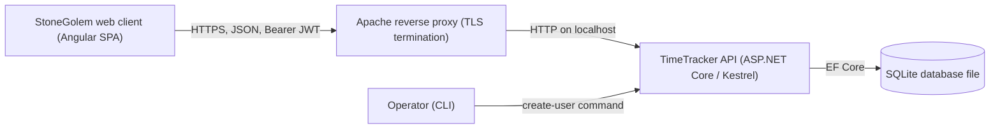
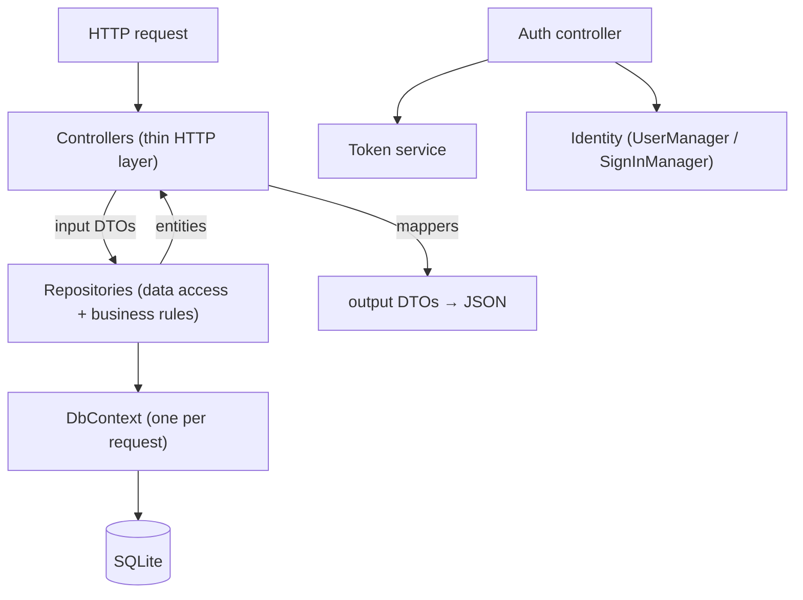
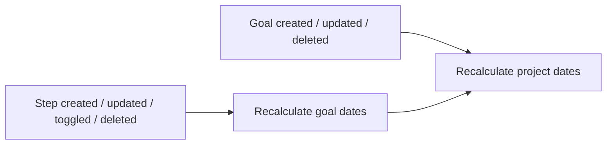
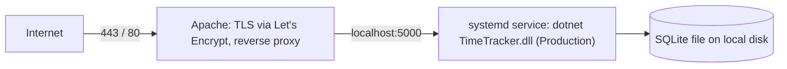

# TimeTracker — Design Document

TimeTracker is the backend service of the **EarthGolem** project. This document describes the system's purpose,
architecture, domain model, business rules, API design, security model and runtime environment. It focuses on stable
design decisions rather than implementation details that change frequently.

---

## 1. Purpose

TimeTracker is a REST API for personal and family time tracking. Users record **steps**: units of work with a
duration, completed on a specific day. Every step is classified along two independent axes:

- **What kind of activity it was:** a step belongs to a **Category**, and categories are grouped into **Areas**.
- **What it contributed to (optional):** a step may belong to a **Goal**, and goals may be grouped into **Projects**.

The service stores this data, derives timeline information for goals and projects, and serves it to a single-page
web client.

The service also hosts two household features migrated from FireGolem:

- **Money:** daily expenses (**payments**) recorded per **payment category** and currency, with day lists, monthly
  reports and a dashboard summary.
- **Blog:** short text **posts** written by users.

---

## 2. System Context



| Component | Responsibility |
|---|---|
| **StoneGolem** | Angular SPA: UI, token storage, automatic token refresh, all user interaction. |
| **Reverse proxy** | Public endpoint, TLS certificates, forwarding to the local API process. |
| **TimeTracker** | Authentication, validation, business rules, persistence. |
| **SQLite** | Single-file relational storage for domain data and identity data. |

Production hosts: API at `earthgolem.perforator.xyz`, client at `stonegolem.perforator.xyz`.

---

## 3. Technology Choices

| Concern | Choice | Rationale |
|---|---|---|
| Runtime / web framework | ASP.NET Core Web API with attribute-routed controllers | Mature, minimal hosting, built-in DI and auth. |
| Persistence | Entity Framework Core with the SQLite provider | Zero-administration storage suitable for a small user base and one server. |
| Identity | ASP.NET Core Identity | Password hashing, user store and per-user token storage out of the box. |
| Authentication | JWT bearer tokens (HMAC-SHA256, symmetric key) | Stateless requests from an SPA hosted on another origin. |
| Serialization | Newtonsoft.Json via MVC integration | Custom converters, such as colors as HTML strings. |
| API description | OpenAPI document and Swagger UI (NSwag) | Interactive exploration with bearer-token support. |

---

## 4. Architecture

### 4.1 Layers



- **Controllers** handle routing, model binding and validation through DTO data annotations and
  `[ApiController]` semantics. They call a repository and map the result to a response DTO.
  They contain no business logic.
- **Repositories** form the application core. Each aggregate root (Area, Category, Project, Goal, Step,
  PaymentCategory, Payment, Post) has its own repository behind an interface. Repositories both query data and
  enforce business rules: transactions, derived values, cascading clean-up. There is no separate service layer.
- **DTOs** define the public contract and are never the persistence entities themselves.
- **Mappers** are hand-written extension methods that convert entities to DTOs and DTOs to entities. No mapping
  library is used.
- **Token service** issues and validates JWTs and is used only by the authentication endpoints.

### 4.2 Dependency and Transaction Model

- All application services are registered with **scoped** lifetime, so one HTTP request shares one `DbContext`
  and one database connection.
- Repositories that maintain derived data depend on each other along the hierarchy:
  **Step → Goal → Project**. A change at a lower level triggers recalculation at the higher levels within the same
  request and the same transaction.
- Every multi-statement write runs in an explicit database transaction. Examples are creating a child together with
  a new parent, deleting with parent clean-up, and changing steps together with recalculation. The transaction is
  either committed as a whole or rolled back.

### 4.3 Response Conventions

- If a repository cannot find an entity, it returns "not found" and the controller responds with **404**.
- Successful operations return:
  - **201** for create (no `Location` header);
  - **200** with the updated representation for update and toggle;
  - **204** for delete.
- Invalid input detected by model validation returns **400** through automatic `[ApiController]` behavior.
- A request that conflicts with existing data returns **409** with a message: a duplicate payment-category name or
  label, or deleting a payment category that still has payments.

### 4.4 Request Pipeline

CORS (named policy for the client origin) → OpenAPI / Swagger UI → routing → authentication → authorization →
controllers. In production, the OpenAPI document advertises the `https` scheme because TLS terminates at the proxy.

---

## 5. Domain Model

```mermaid
erDiagram
    AREA ||--o{ CATEGORY : contains
    CATEGORY ||--o{ STEP : classifies
    USER ||--o{ STEP : performs
    PROJECT |o--o{ GOAL : groups
    GOAL |o--o{ STEP : "advanced by"

    AREA { int Id; string Name; color Color; string Description }
    CATEGORY { int Id; string Name; string Description; int AreaId }
    PROJECT { int Id; string Name; color Color; string Description; status Status; date StartDate; date EndDate }
    GOAL { int Id; string Name; string Description; status Status; date StartDate; date EndDate; int ProjectId }
    STEP { int Id; int Duration; date CompletedOn; date UpdatedOn; bool IsDeleted; string Description; string UserId; int CategoryId; int GoalId }
```

Money and Blog entities are independent of the time-tracking model:

```mermaid
erDiagram
    PAYMENT_CATEGORY ||--o{ PAYMENT : classifies
    USER ||--o{ POST : writes

    PAYMENT_CATEGORY { int Id; string Name; string Label; string Description }
    PAYMENT { int Id; int Amount; date SpentOn; string Currency; int CategoryId }
    POST { int Id; string Title; string Body; datetime CreatedOn; bool IsDeleted; string UserId }
```

### 5.1 Entities

| Entity | Role | Key attributes |
|---|---|---|
| **Area** | Top-level activity domain, such as "Health" or "Work". It owns the color shown for its categories. | name, color, description |
| **Category** | Concrete activity type inside exactly one Area. | name, description, area (required) |
| **Project** | Optional container for goals with an open/closed lifecycle. It owns the color shown for its goals. | name, color, description, status, derived start/end dates |
| **Goal** | Outcome that steps contribute to. A goal may exist without a project. | name, description, status, derived start/end dates, project (optional) |
| **Step** | Atomic time entry made by a user on a given day. | duration, completion date, last-update date, deleted flag, description, user, category (required), goal (optional) |
| **User** | Identity user that authenticates and authors steps and posts. | user name, password hash |
| **PaymentCategory** | Expense category. Named `PaymentCategory` to avoid a clash with step categories. | name, short label, description |
| **Payment** | One household expense. | amount, spending date, currency, payment category (required) |
| **Post** | Blog entry. | title, body, creation timestamp, deleted flag, author (required) |

### 5.2 Value Semantics

- **Duration** is an integer number of **minutes**. The client formats it into weeks, days, hours and minutes.
- **Dates** use date-only values without time or time zone: `yyyy-MM-dd` in JSON and in storage.
  - `CompletedOn` is supplied by the client.
  - `UpdatedOn` is set by the server to the server's current local date.
- **Status** (project and goal) is a two-state enum, `Open = 0` and `Closed = 1`, serialized as a number.
- **Color** is modeled as a color value and exchanged and stored as an HTML hex string (`#RRGGBB`). A dedicated
  JSON converter and a persistence value converter handle the conversion. By convention, an entity has at most one
  color property.
- **Names** are short labels (up to 36 characters). **Descriptions** are free text up to 500 characters.
  Length limits are enforced at the API boundary.
- **Derived counters:** categories and goals expose `stepCount`, the number of their **non-deleted** steps.
  It is computed and not stored. Payment categories expose `paymentCount`, computed the same way.
- **Amount** (payment) is a positive integer in **whole currency units**. Fractional amounts are not modeled.
- **Currency** is an enum (`PLN`, `EUR`) stored and serialized as its 3-letter code string, unlike the numeric
  status enums. Adding a currency means adding an enum member.
- **Currency totals** are lists of `{currency, amount}` that always contain every currency in enum order, with zero
  for currencies without payments.
- **Post timestamps:** `CreatedOn` is a UTC date-time set by the server and serialized with a `Z` suffix.
- **Payment-category names** (up to 36 characters) and **labels** (up to 4 characters, optional) are unique,
  case-insensitively (SQLite `NOCASE`, ASCII only). An empty label is stored as `null`.
- **Post titles** are up to 255 characters. **Post bodies** are unbounded plain text; line breaks are preserved.

### 5.3 Referential Rules

| Relationship | Optionality | On delete of parent |
|---|---|---|
| Category → Area | required | Categories are deleted with the area (cascade). |
| Step → Category | required | Steps are deleted with the category (cascade). |
| Step → User | required | Steps are deleted with the user (cascade). |
| Goal → Project | optional | Blocked while goals reference the project (no action). |
| Step → Goal | optional | Blocked while steps reference the goal (no action). |
| Payment → PaymentCategory | required | Blocked while payments reference the category (restrict). |
| Post → User | required | Posts are deleted with the user (cascade). |

The database enforces these rules through foreign-key constraints.

---

## 6. Business Rules

### 6.1 Derived Timeline of Goals and Projects

Start and end dates of goals and projects are **never set by clients**. They are derived from the data:



- **Goal:**
  - `StartDate` is the earliest `CompletedOn` of its non-deleted steps.
  - `EndDate` is the latest `CompletedOn` of its non-deleted steps.
  - Both dates are empty when the goal has no active steps.
- **Project:**
  - `StartDate` is the earliest start date of its goals.
  - `EndDate` is the latest end date of its goals.
  - Both dates are empty when the project has no goals.
- Recalculation happens in the same transaction as the change that triggers it.

### 6.2 Parents Exist Through Their Children

Areas and projects mainly organize their children:

- Deleting the **last category** of an area also deletes the area.
- Deleting the **last goal** of a project also deletes the project. Otherwise, the project's dates are recalculated.

### 6.3 Creating a Child Together with a New Parent

To support the client's single-form workflow:

- A category can be created either for an existing area (`areaId`) or together with a new area (embedded `area`
  object). If an embedded area is provided, it is created first and takes precedence.
- A goal can be created for an existing project (`projectId`), without a project, or together with a new project
  (embedded `project` object).

Both operations are atomic.

### 6.4 Soft Deletion of Steps and Posts

- Steps and posts support **soft deletion**. A toggle operation flips the deleted flag; for steps, it also stamps
  `UpdatedOn` and recalculates goal and project dates. Deleted items can be restored the same way.
- Deleted steps are excluded from step counters and derived dates. Step and post listings can show active, deleted
  or all items.
- Steps and posts can also be removed permanently. All other entities are removed only permanently.

### 6.5 Lifecycle Status

Projects and goals have an independent manual **Open/Closed** status that is changed by a toggle operation.
Status is informational: it does not affect derived dates, counters or child entities, and project and goal
statuses are not linked.

### 6.6 Data Ownership Model

All domain data is **shared by all authenticated users**. Areas, categories, projects, goals, payment categories and
payments have no owner, and every user sees every step and post. A step records its author:

- By default, the author is the authenticated user.
- The client may set the author explicitly.

A post records its author too, but the author is always the authenticated user who creates the post; it is never
accepted from the client and never changes. Any authenticated user may edit, toggle or delete any post.

There are no roles. The model targets a small, trusted group of users, such as a household.

### 6.7 Money

- **Currencies are never converted.** Every total (day, month, category, summary) is kept per currency.
- A payment references its category by id. An unknown category id is invalid input (**400**).
- A payment category that still has payments cannot be deleted (**409**); reassign or delete its payments first.
- The monthly report lists **every** payment category, with zeros where nothing was spent, in ascending id order —
  the same order as the payment-category list, so clients can render a matrix with category labels as column
  headers.
- The summary returns the totals of a given day and of that day's whole calendar month. The day defaults to the
  server's current local date.

---

## 7. API Design

### 7.1 Conventions

- Base path `/api/<resource>`. Resources: `auth`, `user`, `area`, `category`, `project`, `goal`, `step`,
  `payment-category`, `payment`, `post`.
- Every resource except `auth` requires a bearer token.
- JSON property names use camelCase.
- Standard operations per resource:

| Operation | Route |
|---|---|
| List | `GET /api/<resource>` |
| Read | `GET /api/<resource>/{id}` |
| Read by name (where applicable) | `GET /api/<resource>/{name}` |
| Create | `POST /api/<resource>` |
| Update | `PUT /api/<resource>/{id}` |
| Delete | `DELETE /api/<resource>/{id}` |
| Toggle (where applicable) | `PUT /api/<resource>/toggle/{id}` |

- Read by name shares the route with read by id: a numeric segment is treated as an id, and any other segment as a
  name. Names are not unique, so a name lookup returns the first matching entity.
- Representation shapes:
  - **Flat:** the entity's own fields and foreign-key ids; used for nested lists and create/update responses.
  - **Full:** the entity with its parent embedded as a flat object plus derived counters, or with its children as flat
    objects for parents.
  - **Group:** a parent together with its children, used to render grouped screens.
  - **Paged:** a page of items plus paging metadata (`pageNumber`, `pageSize`, `totalCount`, `totalPages`,
    `hasNextPage`, `hasPreviousPage`).
- Input DTOs are separate for create and update. Server-managed fields, such as ids, derived dates, counters, status
  and `UpdatedOn`, are never accepted from clients.

### 7.2 Resources

| Resource | Operations | Specifics |
|---|---|---|
| `auth` | `POST login`, `POST refresh` | Anonymous. Both return a token pair `{token, refreshToken}`. |
| `user` | list, `GET me` | Read-only. Users are provisioned out of band (see §8.3). |
| `area` | list, read by id, read by name, create, update, delete | Full representation embeds the area's categories. |
| `category` | list (optional filter by area name), `GET group`, read, create, update, delete | The group view returns areas with their categories. Create accepts an embedded new area. |
| `project` | list, read by id, read by name, create, update, toggle, delete | Full representation embeds the project's goals. |
| `goal` | list (optional filter by project name or `null` for goals without a project), `GET group`, read, create, update, toggle, delete | The group view returns projects with their goals, plus a group for goals without a project. Create accepts an embedded new project. |
| `step` | list, `GET group`, read, create, update, toggle, delete | Full representation embeds the user, the category with its area, and the goal with its project. |
| `payment-category` | list, read, create, update, delete | Ordered by ascending id. Full representation adds `paymentCount`. Create and update return the flat representation. |
| `payment` | list (optional filter by `date`), `GET group`, `GET report`, `GET summary`, read, create, update, delete | Full representation embeds the payment category as a flat object. |
| `post` | list (paged, filter `showPosts`), read, create, update, toggle, delete | Full representation embeds the author. Newest first. |

### 7.3 Step Listing and Day-Based Paging

- `GET /api/step?showSteps={active|deleted|all}&date={yyyy-MM-dd}` returns a flat list. `date` is optional.
- `GET /api/step/group?showSteps=…&pageNumber=…&pageSize=…` groups steps **by completion date**, newest day first.
  Paging applies to **days, not steps**: a page contains `pageSize` distinct days, each with all of its matching
  steps.
- Steps follow natural recording order: in the flat list and within each day, they are ordered by ascending id
  (earliest recorded first). Days in the grouped view are ordered newest first.
- Lists of categories and goals are ordered by descending id (most recently created first).

### 7.4 Money and Blog Listings

- `GET /api/payment?date={yyyy-MM-dd}` returns a flat list in ascending id order. `date` is optional.
- `GET /api/payment/group?pageNumber=…&pageSize=…` groups payments **by spending date**, newest day first. Paging
  applies to **days**. Each day carries its per-currency totals and its payments in ascending id order.
- `GET /api/payment/report?pageNumber=…&pageSize=…` returns **months** that have payments, newest first. Each month
  carries `year`, `month`, per-currency totals and per-category totals for every category.
- `GET /api/payment/summary?date={yyyy-MM-dd}` returns `date`, `day` totals and `month` totals.
- `GET /api/post?showPosts={active|deleted|all}&pageNumber=…&pageSize=…` pages posts ordered by creation time and
  then id, newest first. `showPosts` defaults to `active`.
- In these endpoints `pageNumber` defaults to 1 and `pageSize` to 20 (allowed range 1–100); out-of-range values
  return **400**. A page beyond the end returns an empty `items` list.

---

## 8. Security Model

### 8.1 Tokens

- **Access token:** a short-lived JWT that carries the user id in the `sub` claim. It is signed with a server-side
  symmetric key, and lifetime is validated with no clock skew.
- **Refresh token:** a longer-lived JWT signed with the same key. The server also stores the current refresh token
  for each user in the Identity user-token store. A refresh token is valid only while it matches the stored value.
- **Refresh flow:**
  1. The client sends both tokens.
  2. The server checks the access token's signature without checking its lifetime.
  3. The server fully validates the refresh token and compares it with the stored value.
  4. The server issues a **new pair** (rotation) and replaces the stored refresh token.
  
  The session therefore slides as long as the client keeps refreshing.
- Each user has **one active refresh session**. A new login replaces the previously stored refresh token.
- Token lifetimes and the signing key come from configuration (see §9).

### 8.2 Client Protocol

The client stores the token pair in browser storage. It attaches `Authorization: Bearer <access token>` to every
request. On `401`, it calls `refresh` once and retries the original request with the new access token. If refresh
fails, the client returns the user to the login screen.

### 8.3 User Provisioning

The API has no self-registration. Users are created by an operator through a command-line mode of the same
executable:

```
create-user --username <name> --password <password> [--email <email>]
```

The command creates the user if it does not exist and exits without starting the web server. Passwords follow the
default ASP.NET Core Identity password policy.

Payment categories have a fixture, `Data/Fixtures/payment-categories.json` (the FireGolem categories with their ids,
which define the report column order). It is loaded by another command-line mode:

```
seed-payment-categories [--file <path>]
```

The command validates the file (field lengths, duplicates), requires an up-to-date database schema, adds the
categories with their ids and skips categories whose id, name or label already exists, so it can be run again. It
exits without starting the web server. Relative paths resolve against the working directory.

### 8.4 Cross-Origin Access

A single named CORS policy allows the configured client origins with any method and header. Allowed origins are
environment-specific.

---

## 9. Configuration

Configuration uses the standard ASP.NET Core layering: `appsettings.json`, then
`appsettings.{Environment}.json`, then environment variables in `Section__Key` form. Environment variables take
precedence.

| Key | Purpose |
|---|---|
| `Jwt:Key` | Symmetric signing key for all tokens. Must be supplied through the environment in production. |
| `Jwt:ExpireMinutes` | Access-token lifetime. |
| `Jwt:ExpireDays` | Refresh-token lifetime. |
| `CorsSettings:AllowedOrigins` | Client origins allowed by the CORS policy. |
| `ConnectionStrings:DefaultConnection` | SQLite connection string. A relative path resolves against the process working directory. |
| `ASPNETCORE_ENVIRONMENT` | Selects Development or Production behavior and settings. |

Development settings use longer token lifetimes and allow the local client origin.

---

## 10. Persistence

- One SQLite file holds both domain tables and ASP.NET Core Identity tables. The file is not under version control.
- The schema is managed by **EF Core code-first migrations**:
  - add migrations with `dotnet ef migrations add <Name>`, keeping them next to the existing model snapshot;
  - apply them with `dotnet ef database update`.
- SQLite has limited `ALTER TABLE` support, so EF may rebuild tables for some schema changes. Review generated
  migrations before applying them.
- To back up the database, stop the service and copy the file, or use SQLite's online `.backup` command.

---

## 11. Deployment



- Target platform: a single Debian server with the .NET runtime or SDK installed.
- The API runs as a **systemd service** under Kestrel's default local endpoint and restarts automatically on failure.
  The signing key and environment name are supplied as service environment variables.
- **Apache** exposes the public hostname, terminates TLS with certbot-managed Let's Encrypt certificates, and proxies
  all traffic to the local Kestrel endpoint.
- First-time setup:
  1. Restore and build the application.
  2. Apply migrations.
  3. Create the initial user.
  4. Register and start the service.
  5. Configure the proxy and certificate.

  The step-by-step guide is maintained in the project's installation document.

---

## 12. Development Conventions

### 12.1 Code Style

- C# with nullable reference types and implicit usings enabled.
- File-scoped namespaces and primary constructors for dependency injection.
- Opening braces on the same line, and collection expressions (`[]`) for initialization.

### 12.2 DTO Naming

| DTO | Purpose |
|---|---|
| `Create<X>Dto` / `Update<X>Dto` | Input |
| `<X>FlatDto` | Output without navigation properties |
| `<X>Dto` | Output with navigation properties and derived values |
| `<X>GroupDto` | Grouped output |
| `Paged<X>Dto` | Paged output |

### 12.3 Mapping

Mapping uses extension methods named `ToDto`, `ToFlatDto`, `ToGroupDto`, `ToModel` and `UpdateModelFromDto`.

### 12.4 Repositories

- Every repository has an interface and is registered as scoped.
- A repository returns `null` when an entity is not found; the controller translates this into **404**.
- Multi-step writes use an explicit transaction with commit on success and rollback plus rethrow on failure.

### 12.5 Invariants to Preserve When Changing Behavior

- Any change to a step's goal, completion date or deleted flag, and any change to a goal's project, must trigger
  derived-date recalculation (§6.1) in the same transaction.
- Derived counters count only non-deleted steps.
- Clients never set derived or server-managed fields.
- Currency totals are never mixed or converted; build them with the shared totals helper so that every currency is
  always present.
- Payment categories that have payments cannot be deleted.

### 12.6 Contract Changes

API contract changes require the corresponding update of the StoneGolem client models.

### 12.7 Secrets and Data

Never commit the database file or production secrets.
